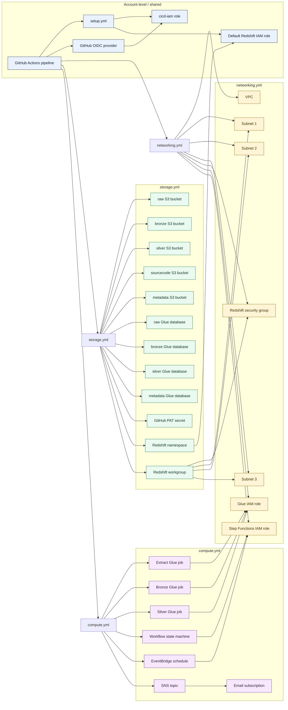

# AWS Batch Data Engineering Infrastructure

This project provisions the AWS resources needed for the `batch_data_engineering_aws` workload and deploys them through GitHub Actions.

It creates the networking, storage, and compute layers for each environment and keeps deployments based on branch and environment naming.

## What it does

This repo sets up the AWS foundation for the data engineering workload:
- GitHub OIDC and IAM setup at the account level
- VPC, subnets, IAM roles, and security groups 
- S3 buckets/Glue catalogs and Secrets Manager entries
- Glue jobs/Step Functions/ SNS topics and Redshift resources
- GitHub Actions pipeline to deploy everything in order

This repo is meant to be used alongside the application code repo (batch_data_engineering_aws) that runs the actual jobs.

## Resource map

The diagram below shows the AWS resources CloudFormation creates in this repo and marks whether they are account-level/shared or environment-specific.

## Assumptions

This setup assumes:
- one AWS account for all environments
- one AWS region for all environments
- `dev` is the first environment deployed
- higher environments like `test`, `uat`, and `prod` follow the same pattern later

The repo only deploys from environment branches such as:
- `dev`
- `test`
- `uat`
- `prod`

Feature branches and bugfix branches are not used for deployment

## Naming conventions

1. Stack names use the pattern `-<branchName>`, except `setup.yml`, which is account-level.
2. Environment-specific resources like S3 buckets and Glue jobs use the suffix `-<env>`.
3. Shared resources are kept reusable where possible to reduce cost.

## How to use it

### 1. Set up GitHub OIDC in AWS

Log in to the target AWS account with a privileged admin user and configure GitHub OIDC authentication.

Then run `setup.yml` manually in CloudFormation and set the initial environment parameter to `dev`.

This creates the IAM role GitHub Actions uses to deploy to AWS. That role:
- is mapped to the GitHub identity provider
- is used for AWS deployments (code and infra) from GitHub Actions. Infra deployed from this repo, while source code is deployed from `batch_data_engineering_aws`
- is created once per AWS account, not per environment
- is reused across environments in the same account

This role also becomes the default IAM role for the Redshift namespaces.

References:
- https://docs.aws.amazon.com/IAM/latest/UserGuide/id_roles_providers_create_oidc.html#manage-oidc-provider-console
- https://docs.github.com/en/actions/how-tos/secure-your-work/security-harden-deployments/oidc-in-aws#adding-the-identity-provider-to-aws

Important:
- `setup.yml` is only run for the first environment (`dev`)
- later environments reuse the same account-level role

### 2. Store the GitHub PAT in AWS Secrets Manager

This project needs a GitHub PAT to call the GitHub REST API during the ingestion job. The secret should not be stored in the repo. Currently, we assume all env have same secret value, so we create only 1 github UI secret, but in secret manager cloudformation creates different secret names based on env.

To reuse this flow:
- create the secret in GitHub under `Settings -> Secrets and variables -> Actions -> Repository secrets`
- the GitHub Actions workflow automatically reads the repository secret, passes it to the deployment process, and the `storage.yml` stack stores it in AWS Secrets Manager per env.

### 3. Trigger the deployment

After step1 and step2:

1. clone the infrastructure repo
2. commit the changes
3. push to the `dev` branch
4. GitHub Actions triggers automatically
5. the cicd pipeline deploys the remaining stacks in this order:
   - networking
   - storage
   - compute

The order matters because some resources depend on the earlier stacks being present.

## Deployment flow

The execution flow is:
1. `setup.yml` runs once per AWS account for `dev`
2. the GitHub PAT is stored in AWS Secrets Manager and referenced by GitHub Actions
3. a push to `dev` triggers the pipeline
4. CloudFormation deploys the stacks in order
5. environment-specific and account specific resources are created with the correct naming convention

## Operational notes

- feature branches do not trigger deployment. Currently it can deploy through dev and prod branch.
- stack names and resource names stay consistent with the naming pattern
- secrets are not hardcoded into code or config files
- deployment order is part of the setup

## Summary

This repo creates the infra for the batch data engineering workload and gives a way to deploy it through GitHub Actions. It handles the infrastructure layer so the application code can be deployed and run in a clean environment.

